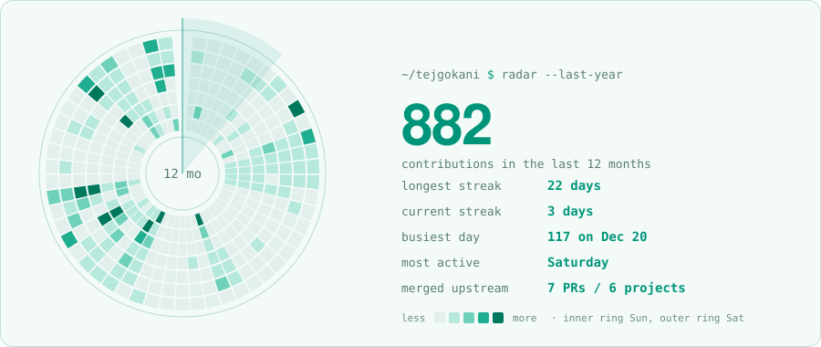

<div align="center">
  <picture>
    <source media="(prefers-color-scheme: dark)" srcset="assets/dark/hero.svg">
    
  </picture>
</div>

<br/>

I build security tools and send fixes upstream. Most of what I write is small, sharp and
local-first: scanners, detectors and terminal consoles that do one job and show their work.
When I find a bug in something I use, I patch it rather than complain about it.

## Merged upstream

Fixes I've landed in other people's projects. This table refreshes itself daily.

<!--UPSTREAM:START-->
| Project | Fix | Merged |
|:--|:--|:--|
| [`falcosecurity/falco`](https://github.com/falcosecurity/falco) | [fix(userspace/engine): backtrack in matches_wildcard](https://github.com/falcosecurity/falco/pull/3913) | 2026-09-04 |
| [`projectdiscovery/depx`](https://github.com/projectdiscovery/depx) | [fix(output): neutralize CSV formula injection in audit export](https://github.com/projectdiscovery/depx/pull/7) | 2026-06-19 |
| [`expressjs/express`](https://github.com/expressjs/express) | [fix: replace deprecated trimRight() with trimEnd()](https://github.com/expressjs/express/pull/7265) | 2026-06-16 |
| [`projectdiscovery/nuclei`](https://github.com/projectdiscovery/nuclei) | [fix(templates): reject unknown fields when loading JSON templates](https://github.com/projectdiscovery/nuclei/pull/7453) | 2026-06-08 |
| [`crowdsecurity/crowdsec`](https://github.com/crowdsecurity/crowdsec) | [fix(docker): bouncer name strips wrong field from Docker secrets path](https://github.com/crowdsecurity/crowdsec/pull/4490) | 2026-05-31 |
| [`projectdiscovery/nuclei`](https://github.com/projectdiscovery/nuclei) | [fix(telnetmini): prevent slice-bounds panic in ParseNTLMResponse on truncated NTLM challenge](https://github.com/projectdiscovery/nuclei/pull/7425) | 2026-05-25 |
| [`koajs/koa`](https://github.com/koajs/koa) | [fix: request.length overflows on Content-Length > 2GB](https://github.com/koajs/koa/pull/1961) | 2026-05-21 |
<!--UPSTREAM:END-->

## Building

<table>
  <tr>
    <td><a href="https://github.com/tejgokani/remotectl"><picture><source media="(prefers-color-scheme: dark)" srcset="assets/dark/card-remotectl.svg"></picture></a></td>
    <td><a href="https://github.com/tejgokani/redoubt"><picture><source media="(prefers-color-scheme: dark)" srcset="assets/dark/card-redoubt.svg"></picture></a></td>
  </tr>
  <tr>
    <td><a href="https://github.com/tejgokani/MYCROFT"><picture><source media="(prefers-color-scheme: dark)" srcset="assets/dark/card-mycroft.svg"></picture></a></td>
    <td><a href="https://github.com/tejgokani/ShipCheck"><picture><source media="(prefers-color-scheme: dark)" srcset="assets/dark/card-shipcheck.svg"></picture></a></td>
  </tr>
  <tr>
    <td><a href="https://github.com/tejgokani/TermiBase"><picture><source media="(prefers-color-scheme: dark)" srcset="assets/dark/card-termibase.svg"></picture></a></td>
    <td><a href="https://github.com/tejgokani/winstonOSINT"><picture><source media="(prefers-color-scheme: dark)" srcset="assets/dark/card-winstonosint.svg"></picture></a></td>
  </tr>
</table>

## Activity

Generated from the GitHub API every day, with no third-party widgets.

<div align="center">
  <picture>
    <source media="(prefers-color-scheme: dark)" srcset="assets/dark/radar.svg">
    
  </picture>
  <br/><br/>
  <picture>
    <source media="(prefers-color-scheme: dark)" srcset="assets/dark/feed.svg">
    
  </picture>
</div>

## Toolbox

<picture>
  <source media="(prefers-color-scheme: dark)" srcset="https://skillicons.dev/icons?i=rust,go,c,py,ts,kotlin,react,nextjs,nodejs,postgres,docker,linux,cloudflare&perline=13&theme=dark">
  
</picture>

## Challenge

If you read security profiles for fun, here's a two-stage one. Solve it and say hi.

<details>
<summary><code>~/.hidden</code> &nbsp;(2 stages, no tools needed)</summary>

<br/>

```
c3RhZ2UgMjogdGhlIGtleSBoaWRlcyBpbiB0aGUgcmF3IHJlYWRtZS4geG9yIGl0LCByZXBlYXRpbmcgdGhlIGtleS4KMTMwZDA1MDgwMjA1MGMxOTNhMTQwNzFhMDExNzA5MzYwNzE2MzgwOTMwMDAxZjA1MDUwMjE4NDc1MjU1NTMwZDAzMWM0ZTAzMDgxZDAxMTc1NDA1MWQ0MDQ1MTQwOTE2NTMxYzA1NTM0ZTExMDIwMjAyMTQxYjA3MDgwMDBjMjcwZjAyMTIxZDAwNDcwZDBhMGE=
```

</details>

<!-- you are reading the raw file, which is the point. key: ghostline -->

---

<div align="center">
  <a href="mailto:tejmgokani@gmail.com">tejmgokani@gmail.com</a>
</div>
